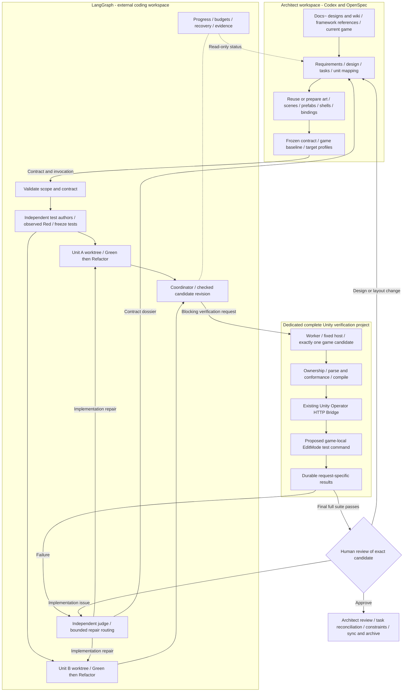

# Design

Adopted follow-up D-28: the user approved provider-controlled temperature for the
selected judge. Temperature zero remains the default; explicit local policy omits
the parameter and preserves reasoning effort. Judge independence, evidence-only
context and deterministic escalation rules remain unchanged. No automatic fallback.

## Context

See proposal.md for motivation and brainstorm.md for user decisions versus
recommended defaults. This is the first overall OpenSpec plan for a framework
whose authoritative docs/ design predates the presentation and human gates.
The source and tests remain superseded wireframes. No existing runtime behavior
is being preserved as a reference implementation.

The four capability deltas describe the intended outcome. They are proposed
planning records until the first application milestone reconciles docs/ through
new superseding decisions. This proposal does not change the repository's current
instructions, generate a game baseline, or start runtime implementation.

Read-only target onboarding now establishes a nested game repository inside a
larger Unity host, with Docs~/ design/wiki sources and an existing HTTP editor
Bridge. This revision captures that integration without modifying the target.
All local installation paths remain machine-local configuration, not repository
examples or contract literals.

## Goals / Non-Goals

**Goals:** make all state transitions attributable to a contract and snapshot;
isolate untrusted coding work; keep execution recoverable; distinguish automated
readiness from human acceptance; preserve the adapter boundary.

**Non-Goals:** change OpenSpec's schema, run Architect reasoning inside the graph,
automate PlayMode acceptance, build a remote execution service, produce final
artwork, or merge/push into mainline. Real Unity and paid models are integration
milestones after the offline foundation, not test-suite requirements.

## Decisions

Application begins on 2026-11-16 with the reviewed behavioral defaults adopted.
The first milestone appends superseding authoritative decisions before any
runtime implementation. Deployment prerequisites remain explicit; they do not
permit target writes, host provisioning, or paid calls beyond available scope.

### 1. Adopt superseding decisions before runtime changes

Use the following review matrix when reconciling authoritative documentation.
Do not edit the text of settled D-01 through D-18 entries; append numbered
superseding entries and update current normative sections with references.

| Existing baseline | Proposed refinement | Rationale |
|---|---|---|
| CodeBuddy Architect | Codex with OpenSpec; delegated apply | User-selected planning environment |
| D-04 permanently retained ownership | Historical retention plus explicit version-boundary migration | Existing files must remain maintainable after repartitioning |
| D-06 two-phase test freeze | Retain phase barrier; add validity review, observed Red, and Refactor | Freeze alone cannot establish TDD |
| D-07 test IDs uniquely attribute failures | Explicit many-unit relationships and snapshot evidence | Current example already shares a test |
| D-11 and conflicting retry table | Immediate STALLED escalation; one bounded regression retry | One deterministic rule must govern execution |
| D-05/D-14 automatic pass finalizes work | Ready-for-review precedes accepted pass | Tests do not establish intended user experience |
| D-13 checkpoint and unit snapshots | Add transactional operation journal and worktree isolation | Checkpoints cannot atomically apply external filesystem effects |
| Generated-file ownership exemption | Retain exemption; independently protect frozen identities/settings | A GUID change can break a frozen scene |
| Informal progress and subprocess invocation | Versioned status/result/review records and delegated apply | Architect must distinguish progress, readiness, and acceptance |
| D-08 local batchmode default | Reuse the target's existing HTTP editor Bridge behind a blocking transport | This host already provides editor control; no new MCP installation is required |
| One project-root assumption | Separate nested game root, external coding roots, and complete verification host | A module worktree cannot run Unity and must not be duplicated under Assets |

D-02 ownership remains immutable within each cycle; D-15 contract_version remains
the only cycle number; D-18 keeps all Unity details behind the adapter. Preserve
the cheap-to-expensive blocking ladder, independent judge, normalized evidence,
run-scoped locks, provenance, budget ceilings, and no mainline writes/pushes.
Clarify the existing 'sole repo write' wording as sole graph write to tracked
planning/convention content: owned implementation/test writes are allowed, runtime
artifacts live under .agent/, and OpenSpec/specs remain read-only to the executor.

### 2. Delegate apply rather than customize the schema

Keep the configured OpenSpec schema. A separately maintained delegated apply
skill reads schema-discovered planning inputs, creates an execution contract,
starts the executor, polls progress, and reconciles results. It must not edit
generated upstream apply skills in place. Normal OpenSpec verification, sync,
and archive remain Architect actions. This avoids confusing an artifact dependency
graph with execution delegation.

Runtime files belong to the target repository, independent of the framework's
own openspec/ directory. The Architect exports the approved feature specification
to specs/<NNN-feature>/spec.md and contracts beside it. Stable task IDs plus change
identity and planning hashes map exported requirements back to their sources;
checkbox line numbers alone are not durable IDs. The graph consumes only this
exported contract/spec bundle plus approved coding/reference inputs, not Architect
conversations or coder preferences. Reuse the game's existing OpenSpec setup;
this framework's planning root must not replace the game's planning root.

Resolve design evidence through Docs~/AGENTS.md and its wiki/index.md, then the
relevant original designs; consult .codex/reference/README.md and its capability
inventory for framework APIs. Summaries are navigation aids, not proof that an
API or gameplay behavior exists. Record source IDs/hashes and resolve conflicts
before export. The executor receives concise relevant constraints and API evidence,
not an indiscriminate copy of the wiki or raw design conversations.

Add a separate format_version field for wire compatibility; contract_version
continues to mean cycle. Require exact consecutive versions on rework, verify the
previous version/hash, and reject changed bytes under an existing version. Store
hashes of referenced spec, baseline manifest, environment profile, and bindings.
Schema formats for status, result, evidence, and review are independently versioned.

Contract additions include task_links, test_links (author, criterion, implementing
unit IDs), presentation_ref, environment_ref, and ownership_migrations. Preserve
unit roles, status, owns, acceptance, depends_on, interfaces, and spec references.
Require valid DAG dependencies, nonempty acceptance mappings for implementation
units, no impl prerequisites for phase-A test authors, portable confined paths,
and no overlapping active ownership. Unchanged existing test paths outside a
production module_root remain valid; new scope requires declared bounds adopted
in the contract schema rather than silently exempting test paths from validation.

### 3. Architect prepares the Unity baseline

Preparation is an Architect-owned operation before final contract publication.
It produces placeholder assets from the visual references, imports them, assembles
scenes/prefabs, creates compilable script shells with stable .meta identities,
wires serialized references and events, and validates a review launch scene.
Preparation occurs in a game-repository checkout outside Unity import, with a
controlled preparation host used to import that checkout and generate Unity
identities. Keep the original interactive project untouched. Baseline assets
belong in the game repository, not the framework or ephemeral worker output.
Reuse existing scenes/bindings, PSD-to-prefab and map tools, and resource services.
Generate only missing feature-specific content. Required shells are actual
contract deliverables, not speculative unused examples; reconcile any target rule
conflict explicitly before installing them. Generation tools are replaceable
Architect tooling; the core does not generate Unity assets or depend on a
particular image service.

The manifest records asset IDs/paths/hashes, GUIDs, importer configuration,
hierarchy/component relationships, required serialized fields and event targets,
runtime mutations allowed by the feature, plus references to source designs.
Artist entries additionally specify dimensions, transparency, variants, pivots,
pixels per unit, slicing, applicable font/material/atlas constraints, and usage.

Frozen files and immutable structural interfaces are different protections:
scenes/prefabs/artwork are immutable content, while owned shell scripts can change
method bodies without changing declared serialized fields, class identities, or
bindings. Unity-specific checks report structured violations through the adapter;
core checks generic protected inputs. Runtime animation or spawning remains legal
when declared; changing authored defaults or bindings does not.

### 4. Use coordinator-owned Git worktrees

```text
Architect-prepared baseline + contract
                  |
       independent test worktrees
                  |
       validate tests / observe Red / freeze all tests
                  |
       +----------+----------+
       |          |          |
    unit A     unit B     unit C       isolated coding worktrees
       |          |          |
       +----------+----------+
                  |
       coordinator integration tree
                  |
       blocking request to dedicated verification worker
                  |
       complete Unity host / one mounted game candidate
                  |
       sequential blocking ladder / Unity EditMode
                  |
       full suite -> human review -> accepted pass
```

All preparation, unit, and integration worktrees are located outside every
Unity-imported directory. The game is a nested independent repository; its
worktrees contain module files, not a full Unity project. Never place them under
Assets/ or assume a worktree of the outer repository populates nested modules.

Each coding worktree starts from a recorded integration/base revision and frozen
test manifest, on an isolated unit ref. The coordinator owns ref creation, Git
metadata operations, patch capture, and integration commits. Coding tools have
write access only to permitted owned files in that workspace; Git shared metadata,
other worktrees, network side effects, and arbitrary shared-tree commands are
denied by the execution host policy. Patch validation remains defense in depth.
Worktrees alone are not a security boundary.

At integration, validate the base, declared dependency revisions, ownership,
protected manifests, and complete change set including additions/deletions/renames.
Use an atomic candidate commit or restore the preceding snapshot on interruption.
No agent writes to integration or verification directly. A candidate depending on
changed inputs must be refreshed and reverified; no blind reuse of Green evidence.

The verification worker alone materializes the game module into a complete
dedicated Unity host; LangGraph does not edit that host. The verification tree
is pinned to the candidate and locked for the whole ladder.
Only expected ignored tool outputs can change there; protected source/import
changes trigger rejection. Coding continues in unit worktrees while the verifier
blocks. The coordinator schedules one verifier call at a time; this is local
scheduling, not a job broker or replacement for the synchronous transport.

### 5. Enforce TDD without contaminating retry evidence

Phase A authors and validates all test units before freezing tests for phase B.
Independent review maps scenarios to assertions, validates test discovery, and
checks Red against the compilable baseline. Shells contain signatures and minimal
nonfunctional behavior, not a prematurely implemented feature. Missing tooling,
invalid tests, and syntax errors are not expected Red.

If tests already pass, record an already-satisfied exception only after independent
coverage review; strengthen coverage before freeze if behavior remains untested.
Never manufacture a production defect to satisfy the stage label. Test preparation
is bounded by its own unit attempt allowance and the global token budget.

An implementation unit proceeds through Red-evidenced, Green coding, Green
verification, Refactor decision/coding, and Refactor verification. Shared tests can
be verified as a declared group once every required candidate is ready. Until then
units retain pending shared verification, not false completion or repeated blame
for a missing peer. Focused tests supply fast feedback; the complete required
EditMode suite must pass for the final candidate, including regression coverage.

Record requested/discovered/executed test IDs, pass/fail/skip/inconclusive counts,
assertion evidence, snapshot identity, and environment fingerprint. Verify all
required tests ran; zero tests or unexpected skips never produce success. Validate
compile inclusion of new files at the real-Unity milestone; do not trust a false
green from an incomplete generated project. Stop at the first failing rung.

Expected baseline Red is not a failed repair. All model calls consume tokens,
including tests, judges, and refactoring. Failed implementation candidates consume
one unit repair attempt, shared across Green, Refactor, and human repair within
the cycle. First failure is RED trend; repeated stable evidence is STALLED and
escalates; proper-subset evidence is PROGRESSING; new failures are REGRESSED.
Normalize gate-specific failing identities, not just error message strings, and
compare equivalent test selections. A later rung is progress over an earlier
rung only on comparable inputs; incomparable evidence requires explicit routing,
not invented convergence. First regression restores safe owned files and permits
one retry within k; a second or exhausted failure budget escalates. A successful
kth candidate passes; exhaustion applies to failures, not a successful last try.

### 6. Route shared failures using evidence

Create an evidence object with related test author, implementing units, candidate
revision, contributing patch identities, and mechanical results. Unit IDs are
contract identities, not coder/model authorship; do not expose coder notes or
identity to the judge. Classify per unit and link common evidence from each entry.

The independent judge can propose a coordinated repair confined to each unit's
ownership. Hold implicated units pending, collect the bounded repair set, and
verify the combined candidate once. Charge each dispatched participant's attempt
at most once for that failed repair round; duplicate evidence polling is free.
Use pre-apply snapshots to restore affected units and invalidate downstream
dependent evidence. Ambiguous interface/scope requirements or no safe repair
partition escalate as contract. Never bisect patches or invent one culprit from
a test/file name. Unrelated units retain inspectable progress.

### 7. Durable progress, recovery, and resource accounting

Under .agent/runs/<run_id>/ keep status.json, progress.jsonl, result.json,
operation records, evidence, reviews, and dossiers. Artifacts use relative paths;
machine-local path resolution belongs to runtime configuration. Status contains
sequence, UTC timestamp/heartbeat, contract identity, per-unit stage/state,
attempts, budgets, and active verification identity. Atomic snapshot replacement
and monotonic sequences permit reconnect; progress is observability, not commands.

Persist operation intent before side effects, including candidate base/hash,
operation ID, snapshot references, and worker ownership. Reconcile a crash after
apply by comparing the actual candidate to before/after identities. Interrupted
verification cannot reuse an old result file; reconcile the old process and
request identity before rerunning. Heartbeat updates continue while verification
blocks. Locks carry owner/run/process identity; liveness and ownership are checked
before reclaiming them. A checkpoint alone never proves external work completed.

Reserve model-call allowance before dispatch and reconcile actual usage after
completion. Unknown interrupted usage retains its reservation. Resume, migration,
or human review never resets run token/cycle accounting. New cycle attempt windows
remain bounded by retained run budgets; migration copies relevant history and does
not grant extra within-cycle attempts. Budget exhaustion abandons safely with a
dossier. Missing tooling is operational, not a unit attempt/cycle. Cancellation
stops new work, reconciles owned workers, retains candidates, and produces a
cancelled result; it does not imply a contract defect.

### 8. Human acceptance is a persisted lifecycle boundary

Successful execution persists awaiting_human_review and a review package, then
can exit. A later local review/resume invocation validates the candidate identity
and explicit human input; it need not hold a model session or verifier lock while
waiting. Keep the run reservation and candidate identity so other work cannot
silently overwrite the pending review. No automated model can approve itself.

Review includes launch scene, steps/interactions, design references, placeholders,
known limitations, and automated evidence. Store reviewer identity, reviewed
revision/baseline/contract hashes, decision, and findings. Implementation findings
resume bounded repair under the same frozen version when possible. Presentation
or requirement changes create rework and return to the Architect; nonrunnable
failures bypass visual review. Every repaired revision needs new evidence/review.

Approval applies to the reviewed source/content snapshot. The final provenance
flush is a coordinator-owned metadata-only commit derived from that approved
snapshot; result records both revisions and verifies that no source, test, asset,
binding, or execution configuration changed. This avoids treating the required
AGENTS.md flush itself as an unexplained change to the reviewed experience.
Only then report accepted pass, reconcile OpenSpec tasks, verify planning coverage,
and separately sync/archive. Human acceptance does not grant permission to push
or merge automatically.

### 9. Ownership migration and artwork replacement

Validate consecutive contracts together. Surviving units keep ownership unless
an explicit migration names the previous owner, new owner, paths, and rationale.
Superseded units retain historical claims; the new active map alone governs
writes. Require complete path accounting, disjoint destinations, justified added
units, scope bounds, and retained growth/cycle budgets. Reject orphaning, silent
reassignment, and use of frozen paths to bypass protection. A migration cannot
transfer frozen tests to an implementation role. Architect baseline changes must
be separately validated before the next version runs.

Artist replacement is a later Architect-controlled change, preserving asset
identities and validating import/layout compatibility plus human visual review.
Incompatible dimensions, font metrics, slicing, or bindings require an explicit
presentation revision. Coding execution never swaps final art mid-cycle.

### 10. Onboard the existing game through portable profiles

Separate these identities in configuration and evidence:

| Identity | Resolution and responsibility |
|---|---|
| Game repository | Independent nested repository; contract paths and owns are game-relative |
| Allowed host mount | Assets/JJGame/monopoly/ for this target; immutable policy outside contract control |
| Host profile | Full Unity environment, editor version, package/setting fingerprints, and each required nested module revision |
| Coding workspace | External preparation/unit/integration game checkouts managed by coordinator |
| Verification workspace | Dedicated complete Unity host managed by worker, never the user's interactive project |
| Run artifact root | Durable .agent/runs/<run_id>/ in the coordinator workspace; worker results copied or referenced by validated relative artifact IDs |

Use runtime configuration to resolve actual machine paths. Serialized profiles
contain portable references and environment-variable/placeholder selectors.
Contract scope is always intersected with the authorized game policy. Keep
module_root and role-specific scope roots inside that boundary; adding a test
scope does not permit another host module. Resolve links/junctions before writes.
Generated-file exemption covers ownership checks, never host-scope escape.

Target onboarding records Tuanjie 1.9.2 / Unity 2022.3.62t10 and installed
com.unity.test-framework 2.0.1-exp.2 as observed inputs, not global defaults.
Export the game AGENTS/rule hashes and relevant source-backed API facts. Preserve:

- jj.Reserve04.Runtime and Reserve04ModuleLoader/Monopoly identities; no new
  runtime asmdef requiring unauthorized HybridCLR/project changes.
- Hot-update restrictions on static state, AOT dependencies, lifecycle hooks,
  serialization, platform storage, and WebGL threading/synchronous loading.
- DI/service lifecycle, paired event/resource cleanup, and use of bifrost
  interfaces rather than sibling-module implementation types.
- Navigator/VVMP navigation, framework resource loading, platform filesystem,
  event, scheduling, configuration, localization, and existing service reuse.
- Runtime/Script code, Tests/Runtime/Script tests, Editor/Script tooling, and
  Runtime/Resource/monopoly resources; artist source/import paths and bundle rules
  follow current game conventions rather than generic generated folders.
- Placeholder assets use the target's _placeHolder suffix; retain .meta identity
  on moves/replacement. Existing code/data generators remain the source of truth.

The adapter checks syntax/dependencies/identities where mechanically possible;
independent compliance review handles semantic lifecycle and API usage. Do not
claim static checks prove correct unloading, platform operation, or UX.

### 11. Materialize candidates without changing the shared framework

Provision a complete dedicated host from explicitly identified host sources,
including nested repositories and private package availability. A clone of only
the outer Git root or of only the game is insufficient. Existing shared source,
packages, and settings are fixed dependencies; do not rewrite them to accommodate
a candidate. Host creation/location and package access are deployment inputs
requiring authorized writable locations, not assumptions made by this proposal.

Maintain exactly one game mount at Assets/JJGame/monopoly/. The worker acquires
exclusive host access, reconciles in-flight Unity operations, and materializes
the requested game snapshot with tracked metadata. Use a verified previous/next
manifest to remove only stale worker-managed candidate files. Never synchronize
over the user's interactive project, follow links outside the mount, copy unit
.git internals into Assets, or run broad cleanup of the host.

Refresh only after materialization is complete. Unity import is a controlled
pre-gate normalization step: any newly generated game-local metadata must be
captured into the candidate identity and returned for coordinator reconciliation
before accepted evidence is issued. Existing frozen identities cannot change.
Restart verification against the reconciled candidate; do not label evidence with
a revision that omits required generated asset identities. During the ladder the
effective source/asset snapshot stays fixed; allow only configured transient
caches, logs, and worker evidence outputs. Detect unauthorized host content changes
and reject the result; stop for controlled reprovisioning instead of fixing shared
code. A pre-existing host mismatch is operational; a candidate-caused protected
write is additionally recorded as a scope/integrity violation.

### 12. Reuse Unity Operator behind the worker boundary

The inspected cn.jj.unity-operator@0.0.1 implements local HTTP, not an MCP server.
GET / reports project identity/health/commands; GET /resource/<name> supplies
queries; POST /execute invokes registered commands; GET /task/<id> tracks Bridge
tasks. Its command registry discovers IUnityOpCommand implementations from loaded
assemblies. The game already extends this registry for fake-protocol injection.
The unrelated Luban MCP example is not an editor-control capability.

Use a target-specific Bridge transport behind VerifyTransport, retaining blocking
graph semantics. Add a narrowly scoped command packaged under the game's editor
or Editor-only test assembly; do not patch Library/PackageCache, Packages, or
shared framework modules. The existing test assembly and editor assembly already
reference jj.UnityOperator.Editor. Reuse TestRunnerApi, as existing game test
helpers do; their fixed filters/XML paths are examples, not the worker contract.
Framework-side command source/templates belong under unity/Editor/ and are later
installed into owned game tooling. Do not install tooling during this proposal.

The worker exposes candidate, host/baseline/profile identities, test IDs/assembly
selection, and request ID, not an arbitrary menu or script-execution facility.
Request submission returns only started/running state. Test callbacks produce a
durable atomic final result keyed by request ID, accompanied by NUnit evidence,
discovery/execution counts, skipped/inconclusive results, diagnostics, and input
hashes. Prefer configured ignored game-local worker storage; transfer artifacts
to the durable run directory before replacing the candidate. Do not overwrite
existing Docs~/Validation reports or treat their presence as current completion.

Bounded discovery must verify status=ok AND the exact verification-host project
path. Never assume the original project's port also identifies its verification
copy. Refresh can trigger compilation/Domain Reload; poll readiness with a deadline,
rediscover the Bridge, verify project identity again, inspect current compilation
and Console evidence, then run tests. A returned refresh/menu success is not proof
of compile or test completion. Parse nested command results as well as outer task
state; the current Bridge can report task success for an inner error response.

Bridge task IDs are memory-local and may disappear or repeat after reload. Durable
worker request IDs and candidate hashes are authoritative. On disconnect or timeout,
reconcile persisted results and active tests before retry; never launch a duplicate
suite blindly. Do not block Unity's main thread waiting for its own asynchronous
test callbacks. Worker polling remains outside Unity's callback execution while
the LangGraph-facing call blocks. Coding agents cannot access the endpoint or
general ExecuteMenuItem. Preparation tools receive only their separately scoped
editor authority.

Read-only discovery during design timed out and found no editor by process-name
check. That is unverified connectivity, not proof the package is defective or tests
pass. Do not start another editor, install packages, or modify shared tools to
make discovery succeed without deployment scope. Batchmode remains an adapter
alternative for a separately validated target, not a mandatory second backend
in this first Bridge integration.

### 13. Revised system graph



The request/response edge is used for baseline Red, Green, Refactor, and final
verification. Structural gates run before the worker reaches behavioral tests;
refresh/readiness is preparation, not a test pass. Full-suite results lead to
review only for a complete candidate. Nonrunnable failures return their normal
operational/rework outcomes without requiring visual review.

## Risks / Trade-offs

- Unity verification can dominate elapsed time: measure gates and retain focused
  feedback plus one required final suite; keep parallel coding independent.
- Prepared shells may constrain implementation: validate binding needs early and
  escalate genuine missing structure instead of silently relaxing freeze.
- Test authors can write weak tests: independent spec coverage review plus human
  acceptance supplements structural freeze; neither proves exhaustive correctness.
- Worktrees share metadata: deny agent metadata access and arbitrary commands;
  deployment without enforceable host restrictions must fail preflight.
- Restoring one unit can invalidate consumers: track dependency revisions and
  invalidate evidence rather than claiming unrelated passing tests remain current.
- Preparation/import may change generated metadata: settle and capture the baseline
  before freeze; distinguish legitimate transient outputs from protected identity.
- Broad roadmap could hide partial delivery: expose each handoff milestone and
  acceptance result independently; a completed plan is not a completed phase.
- Nested host dependencies/private packages can prevent a fresh verification copy
  from importing: provision and fingerprint the complete host before dispatch.
- Bridge tasks are not durable test runs: correlate callbacks and saved results
  with request/candidate identities and reconcile across reload, timeout, and retry.
- Unity import can write outside the game mount: protect shared content, isolate
  operational output, and reject contaminated results rather than accepting drift.

## Migration Plan

1. Review these artifacts and adopt superseding docs decisions first. Keep settled
   entries intact; update HANDOFF acceptance/build order and illustrative contracts.
2. Build Phase 0 packaging/stub graph, then Phases 1-5 using offline fakes. Author
   and freeze each milestone's acceptance tests before implementation.
3. Add generic protected manifests, status/recovery, isolated execution and human
   review state with fakes before any real Unity/model dependency is required.
4. At Phase 6, demonstrate compilation inclusion, preparation/bindings, sequential
   EditMode TDD, shared failure routing, and review on a dedicated disposable
   verification host matching the target profile. Reuse the existing Bridge and
   test assembly; keep the user's interactive project unchanged.
5. Complete Phase 7 branch/provenance/governor acceptance, then integrate delegated
   apply, final acceptance, and artist-replacement rehearsal. Never skip foundational
   gates just because a later planning artifact exists.

Rollback retains old contracts and cycle branches. Abandon/cancel/operational
cleanup restores managed integration state as needed and leaves the user's starting
branch/worktree untouched. Do not delete user work or use forgotten stashes.

## Open Questions

No unresolved question changes this proposal's scope or task breakdown. Per-target
Unity/package versions, scene identity, model IDs, generated-asset tools, and
measured gate timings are deployment inputs. Dependencies beyond the expected
LangGraph/tree-sitter stack require a separate rationale before introduction.
Concrete host provisioning source/revisions, writable external locations, private
package access, live Bridge discovery, and test inclusion/compile timing are
deployment preflight inputs and acceptance work, not design blockers. The current
target editor version is known; reachability and actual tests remain unverified.
